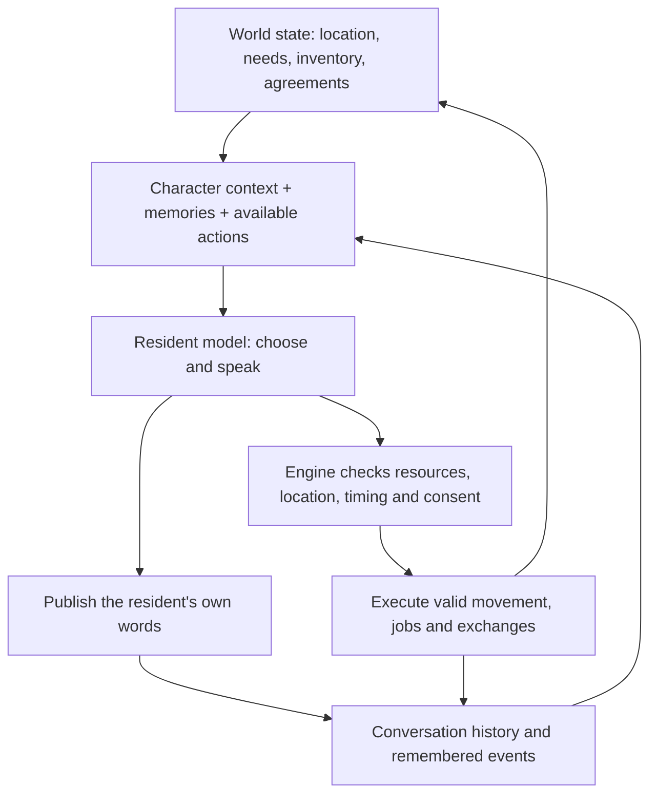

# Willowbrook

### A persistent village where AI residents remember, work, trade, and talk.

Willowbrook is a medieval riverside simulation centered on **Bob, Lucky, and Stella**. Each resident has an authored personality, physical needs, possessions, relationships, and memories. Language models choose activities and speak in their own words; a persistent game engine handles movement, resources, time, and the consequences of their choices.

Built from [a16z's AI Town](https://github.com/a16z-infra/ai-town), this version expands the original social simulation into a village with professions, an economy, resident sheets, a council room, model controls, and recorded action outcomes.

**[Setup & migration guide](WILLOWBROOK-HANDOFF.md)** · **[Character profiles](data/worldContext.ts)** · **[Tests](tests/)** · **[License](LICENSE)**

## Meet the residents

| Resident | Life in the village | Personality |
| --- | --- | --- |
| **Bob** | Tends the garden, grows turnips, manages seeds, and trades produce. | Reserved, observant, and dryly funny. Values reliability and practical skill; companionship matters more to him than he readily admits. |
| **Lucky** | Fishes at the river, visits neighbors, and trades his catch. | A curious returning storyteller, torn between another journey and becoming someone his neighbors can rely on. |
| **Stella** | Runs the market and the Hearth & Reed courtyard kitchen, turning ingredients into meals. | Quick-witted and commercially minded. Wants security and influence, but also friendships that are more than transactions. |

Their histories, values, blind spots, and voices are authored. Experiences change their stored memories, relationships, needs, and decision context. They do not retrain their model weights as they live in the village.

## What has grown beyond the starter

| System | What Willowbrook adds |
| --- | --- |
| **A working village** | Homes, a garden, fishing bank, market, and tavern courtyard, with travel and collision-aware movement. |
| **Professions and exchange** | Fishing, gardening, cooking, food consumption, barter, gifts, and cooking commissions. Inventory and consent determine which exchanges can execute. |
| **Needs and daily life** | Hunger, energy, restedness, stress, rest, and sleep influence available choices. One real minute equals one village hour while the simulation runs. |
| **Memory and relationships** | Persisted conversations, summaries, vector retrieval, witnessed events, individual perspectives, and changing relationship attributes. |
| **Resident sheets** | Select a character to inspect their personality, stats, relationships, memories, current activity, and decision history. |
| **Town presentation** | An expanded pixel-art view, world clock, day/night tinting, lighting, and activity/conversation panels. |
| **Council room** | A separate space for topic-led conversations using the residents' identities and remembered context. |
| **Model controls** | Provider configuration, per-character model assignments, request diagnostics, token accounting, estimated costs, and application budgets. |
| **Direct movement** | Select a resident and right-click reachable ground to direct a walk without a model request. |
| **Behavior records** | Logs distinguish what a model chose, what it said, what the engine accepted, and what actually completed. |

The design goal is continuity: a conversation should matter to the next encounter, and an action should change something in the shared world.

## How the models and engine work together



The engine owns physical truth. A model saying “I gave you a fish” does not transfer inventory. A supported transfer must be selected, validated, and executed. Likewise, an activity-choice card shows an intention, not proof that the activity finished.

**Current town dialogue paths:**

- **Bob ↔ Lucky:** normally two generation calls per turn—choose actions, then speak with the chosen plan and validation result as context. The speech response may propose a replacement plan, which is also validated.
- **Conversations involving Stella:** ordinarily one structured dialogue call, including optional action metadata.
- **Council:** a separate discussion flow. Mentioning an action there does not execute it in the town.

Live speech is not gated by a semantic reviewer. An invalid action can be rejected while recoverable dialogue is still published. Repetition detection supplies feedback to the next existing prompt; it does not mute the speaker, rewrite their reply, add a call, or force a conversation ending.

These choices preserve the models' own words, but **speech and action can still disagree**. The project records the distinction rather than treating every spoken promise as completed work.

## Explore the town

- **Live / Pause:** advance or stop the simulation clock.
- **Select a resident:** inspect their sheet and follow their current activity.
- **Right-click open ground while Live:** direct the selected resident to walk there. Obstacles still apply; manual movement temporarily takes priority over autonomous decisions.
- **Stop walking:** release a directed walk from the resident panel. Some active group activities must finish before a manual walk can interrupt them.
- **Council:** introduce a topic and watch the residents discuss it.
- **Models & usage:** inspect provider settings, assignments, requests, and estimated spending.

## Run on another PC

The maintained setup uses **Node 24** and **pnpm 11.25.0**. The exact verified Node version is recorded in [.nvmrc](.nvmrc). Use `pnpm-lock.yaml`; the inherited npm lockfile is not the current dependency baseline.

```powershell
npm install --global pnpm@11.25.0
git clone https://github.com/Vishukk1503/Ai-town-willbrook.git
cd Ai-town-willbrook
pnpm install --frozen-lockfile
```

### First setup

Follow the **[new-PC guide](WILLOWBROOK-HANDOFF.md#4-new-pc-restore-the-existing-town)** to:

1. Configure a fresh local Convex deployment.
2. Import the private saved-world backup to continue the same town.
3. Configure the Groq key in the backend.
4. Install and run the Ollama models required by the existing memory path.
5. Start the frontend and verify the restored world before pressing Live.

**Cloning this repository copies the code, not the residents' history.** Conversations, relationships, memories, inventories, and model settings live in the database. The saved-world archive is separate and private.

Do not run `init` or `pnpm dev` before restoring the backup: the inherited `predev` command initializes a world. Starting an empty village is a separate route described in the guide and does not reproduce all saved village setup or accumulated history.

### Normal launches after setup

```powershell
pnpm run town
```

On Windows, you can also double-click **[Start-Willowbrook.cmd](Start-Willowbrook.cmd)**.

Open **http://127.0.0.1:5173/ai-town**. Keep the launcher terminal open; Ctrl+C stops it. The launcher starts Convex and Vite without initializing a new world or automatically resuming a paused one. Stop separately running development servers before launching it.

### Model dependencies

Resident dialogue uses the configurable provider path, with Groq configured in the saved town and per-character model overrides. The handoff guide records the model assignments at export; they are configuration, not fixed character identities.

The older memory and reflection path still uses Ollama locally:

```text
ollama pull all-minilm
ollama pull qwen3:1.7b
```

Keep Ollama running. The restored memory vectors use **384-dimensional embeddings**; changing the embedding model requires a migration plan.

Windows users can run **[Connect-Groq.cmd](Connect-Groq.cmd)** after configuring the backend. It prompts for the key with hidden input. Keep API keys in backend environment configuration, never in `VITE_*` variables or committed files.

## Development map

| Area | Entry points |
| --- | --- |
| Town interface | [WorldApp.tsx](src/WorldApp.tsx), [WorldGame.tsx](src/components/WorldGame.tsx) |
| Resident and council UI | [ResidentSheet.tsx](src/components/ResidentSheet.tsx), [Council.tsx](src/components/Council.tsx) |
| Character identities | [worldContext.ts](data/worldContext.ts), [characterContext.ts](data/characterContext.ts), [socialProfiles.ts](data/socialProfiles.ts) |
| Simulation and actions | [convex/engine](convex/engine/), [convex/aiTown](convex/aiTown/) |
| Bob–Lucky dialogue | [townJoint.ts](convex/townJoint.ts), [jointThreeStage.ts](convex/aiTown/jointThreeStage.ts) |
| Other town dialogue | [conversation.ts](convex/agent/conversation.ts) |
| Repetition feedback | [repetitionFeedback.ts](convex/aiTown/repetitionFeedback.ts) |
| Memory and relationships | [memoryGraph.ts](convex/memoryGraph.ts), [social.ts](convex/social.ts), [memory.ts](convex/agent/memory.ts) |
| Providers and accounting | [modelReply.ts](convex/modelReply.ts), [modelSettings.ts](convex/modelSettings.ts), [modelCosts.ts](convex/util/modelCosts.ts) |
| Regression coverage | [tests](tests/) |

The stack is **TypeScript, React, Vite, PixiJS, and Convex**, with Groq for the configured resident dialogue and Ollama for the existing local memory dependencies.

### Checks

```powershell
pnpm run test --runInBand
pnpm run build
```

At the **November 13, 2026 handoff**, the full suite passed **295 tests across 34 suites**, and the production build passed. These are recorded checks, not a live CI badge or a guarantee of dialogue quality. A clean installation and restore on the destination PC still need verification there.

## Current boundaries

- Dialogue can still invent facts or promise actions that were not selected. Engine validation prevents unsupported physical execution; it cannot guarantee truthful speech.
- Bob–Lucky and Stella interactions use different call paths. Historical reviewer and prototype files remain in the repository but do not all run in the live town.
- New physical capabilities require engine support. Procedural dungeons, a continuously observing world-builder model, and arbitrary model-created actions are not implemented.
- The simulation persists state between requests; the language models themselves are not continuously running minds.
- The current setup is intended for local development. Authentication is disabled in the frontend, and development mutations need an access-control review before public hosting.
- At handoff, Groq was returning `spend_limit_reached`. Restoring the town or changing the app budget does not clear a provider billing block.

See the **[handoff guide](WILLOWBROOK-HANDOFF.md)** for detailed architecture, restoration steps, logs, and known limitations.

## Attribution and license

Willowbrook is a modified version of **[AI Town by a16z-infra](https://github.com/a16z-infra/ai-town)**. The original **[MIT license](LICENSE)** is retained. AI Town was inspired by *[Generative Agents: Interactive Simulacra of Human Behavior](https://arxiv.org/abs/2304.03442)*.

The inherited project and asset credits remain:

- **Engine/backend foundation:** [Convex](https://convex.dev/); rendering and sound integration use [PixiJS](https://pixijs.com/).
- **Tilesheets:** [George Bailey's 16×16 game assets](https://opengameart.org/content/16x16-game-assets) and [hilau's 16×16 RPG tileset](https://opengameart.org/content/16x16-rpg-tileset).
- **Original forest assets:** [Tiny RPG Forest by ansimuz](https://opengameart.org/content/tiny-rpg-forest).
- **Original UI assets:** [Pixel Art GUI Elements by Mounir Tohami](https://mounirtohami.itch.io/pixel-art-gui-elements).
- **Original proof of concept:** [phaser3-simple-rpg by pierpo](https://github.com/pierpo/phaser3-simple-rpg).
- **Upstream asset generation:** [Replicate](https://replicate.com/), [Fal.ai](https://fal.ai/), and [MusicGen](https://huggingface.co/spaces/facebook/MusicGen).

Third-party assets retain their respective licenses and attribution requirements.