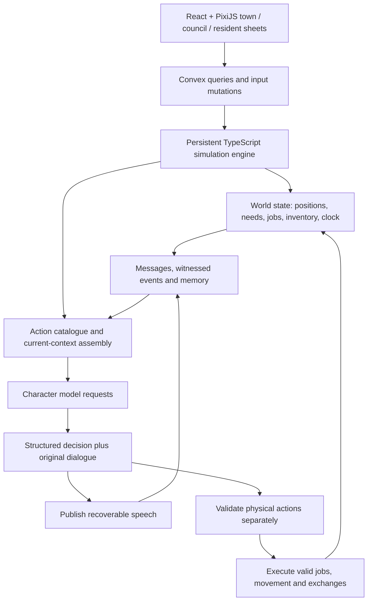

# Willowbrook — project handoff and new-PC guide

Updated: 2026-11-13. This document describes the actual implementation at handoff, not a proposed replacement architecture.

## 1. What this project is

Willowbrook is a medieval-flavored, persistent village simulation built on the a16z AI Town starter. Three residents—Bob, Lucky, and Stella—have authored identities, needs, inventories, relationships, memories, and available activities. Language models choose and discuss intentions. A TypeScript simulation engine validates and executes physical actions, manages time, and saves world state in Convex.

The goal is convincing continuity: people who remember experiences, have distinct voices, and act within a shared world. The models are API requests, not continuously running or conscious minds. Persistence belongs to the database and simulation. The village can continue changing between model responses while its engine is running; pressing Pause stops simulated time.

The interface has a large pixel-art town, resident sheets, activity/conversation feeds, a council room, model settings, usage records, and day/night lighting. Council is a controlled discussion surface; it is not identical to the live town execution flow.

## 2. What to transfer

| Item | Where it belongs | What it preserves |
|---|---|---|
| Source repository | GitHub | Engine, UI, authored characters, maps/assets, tests, setup scripts, this guide |
| `Willowbrook-world-2026-11-13.zip` | Private migration backup in Drive | Current world, inventories, needs, dialogue, memories, relationships, model settings, usage records |
| Groq API key | New backend's environment configuration | Permission to make provider requests; enter again on the new PC |
| Local Convex deployment/admin credentials | Generated fresh on the new PC | Access to that PC's backend; do not copy into Git |
| Ollama models | Install/pull separately | Local embedding and legacy memory-model dependencies |

**Cloning code alone does not restore the characters' lived history.** Restore the database snapshot to continue the same town. The backup is a portable Convex export, not a copy of the live SQLite file. Do not upload `.env.local`, `.convex`, API keys, or raw backend databases to GitHub.

The original upstream remote is `https://github.com/a16z-infra/ai-town.git`. The user-owned repository is https://github.com/Vishukk1503/Ai-town-willbrook. The owner explicitly approved publishing the source and dialogue test fixtures publicly. Do not push project changes to the upstream repository. The saved world remains private on Drive.

## 3. Verified baseline

- Source ancestry: upstream commit `1b2f7d8` plus the Willowbrook changes.
- Current verified runtime: Node `24.22.1`, pnpm `11.25.0`, Convex package `1.49.0` as resolved by `pnpm-lock.yaml`.
- Use **pnpm with the committed lockfile**. The inherited `package-lock.json` resolves an older Convex version; it is not the authoritative lockfile for this handoff.
- Local frontend: `http://127.0.0.1:5173/ai-town`.
- Current local Convex API: `http://127.0.0.1:3210`; a new configuration may choose another port.
- World was explicitly paused when exported.
- Full automated suite: **34 suites, 295 tests passed** before packaging.
- Production build passed after correcting a branded-ID type annotation in a regression test. The focused 11 repetition tests passed again through the portable test command.
- Latest speech/repetition changes also passed focused tests and backend deployment typechecking.
- No live provider calls were made to validate the final repetition-feedback change; mocked requests verified call counts and prompt delivery.

The source has accumulated prototypes alongside runtime code. Passing tests are useful evidence of the covered behavior, not proof that every generated conversation is consistent or every migration platform has been exercised.

## 4. New PC: restore the existing town

### Prerequisites

Install Git, Node 24 (the checked-in `.nvmrc` records the verified version), and pnpm 11.25.0. The project does not require Codex to run. Use a terminal in a folder you own. For the existing memory implementation, install Ollama as described below.

```powershell
npm install --global pnpm@11.25.0
git clone https://github.com/Vishukk1503/Ai-town-willbrook.git
cd Ai-town-willbrook
pnpm install --frozen-lockfile
```

Use your actual repository URL from the delivery message. Do not clone the upstream AI Town repository expecting it to contain these changes.

### Configure a fresh local Convex deployment

In terminal A, from the repository root:

```powershell
pnpm exec convex dev --configure new --dev-deployment local
```

Follow the CLI's project/account prompts if it asks. Let it deploy the schema and functions and keep this terminal running. This creates machine-specific configuration and `.env.local`. The generated frontend URL should match the actual backend port.

**Do not run `init` or `pnpm dev` before importing the saved world.** The inherited `predev` script runs initialization. We want the new deployment empty for the import. `convex dev` itself deploys functions without initializing residents.

If the CLI needs a project name, use a new development project for this local copy. Do not select an unrelated existing deployment containing valuable data.

### Import the saved world

Download [Willowbrook-world-2026-11-13.zip](https://drive.google.com/file/d/1UwNVTzfzCwmuVTfNVKPUjNcSxbq6YbKT/view) from the owner's private Google Drive. Its upload was separately approved and completed. The Markdown file does not include the database. In terminal B, in the repository:

```powershell
pnpm exec convex import "C:\path\to\Willowbrook-world-2026-11-13.zip"
pnpm exec convex run world:defaultWorldStatus
```

The imported default world should say `stoppedByDeveloper`. If it does not, pause it before continuing:

```powershell
pnpm exec convex run testing:stop
```

Import into a **new empty deployment**. If the CLI reports existing tables or conflicting documents, inspect which deployment is selected instead of blindly using `--replace-all`. Import replacement is destructive to the target deployment. The source snapshot remains intact.

Do not import the same snapshot repeatedly into a running town. Confirm the import succeeded before pressing Live. Verify that the expected three residents, village places, old conversations, and inventories appear.

### Restore model dependencies and credentials

The Groq key is backend configuration and is not part of the export. With Convex still running, Windows users can double-click:

```text
Connect-Groq.cmd
```

This opens a hidden-input prompt via `scripts/Connect-Groq.ps1`, passes the key to Convex over stdin, and does not print it or save it in a frontend file. Its execution-policy override applies only to that PowerShell process, not system-wide policy.

On other operating systems, set `GROQ_API_KEY` using the Convex dashboard's backend environment settings. Never add provider keys to `VITE_*` variables, Git, the Markdown guide, or chat.

Set up Ollama for existing memory features:

```text
ollama pull all-minilm
ollama pull qwen3:1.7b
```

The current code defaults to Ollama at `http://127.0.0.1:11434`, `all-minilm` for 384-dimensional embeddings, and `qwen3:1.7b` for the legacy local completion path. Ensure Ollama is running. These are code defaults; if you deliberately configured another compatible model previously, restore that configuration instead.

**Groq dialogue does not eliminate the Ollama dependency.** Legacy conversation summaries/reflections and vector retrieval still use `convex/util/llm.ts`. The three resident Groq overrides use the newer `modelReply` path. Do not change embedding dimension or embedding models casually after restoring stored vectors.

### Start the frontend

While terminal A keeps Convex running, use terminal B:

```powershell
pnpm run dev:frontend --host 127.0.0.1 --port 5173 --strictPort
```

Open `http://127.0.0.1:5173/ai-town`. Check Models & usage, confirm the configured provider/models, and resolve billing before testing a model request. Press **Live** only when ready.

### Normal launches after setup

Stop the separate development processes before using the combined launcher, so duplicate processes do not compete for ports.

```powershell
pnpm run town
```

On Windows, double-click `Start-Willowbrook.cmd` in the cloned repository. You can create a desktop shortcut to this file. The launcher resolves its directory relative to the repository, uses Node from PATH, starts Convex and Vite, and leaves their logs in its terminal. Keep the terminal open. Ctrl+C stops the launcher.

The new launcher deliberately does not call `init` or resume a paused town. It is separate from the original PC's legacy launcher, which contained absolute paths and a manually managed backend process. Do not copy that old machine-specific launcher to the new PC.

## 5. Starting a new village instead

Restoring the backup is the recommended way to continue this project. If you intentionally want a blank village, use a separate empty deployment, configure providers, then run `init`. Additional builder functions exist for the garden, economy, livelihood system, and village places (`settlement.ts`, `economy.ts`, `livelihood.ts`, `village.ts`). They have prerequisites and are not equivalent to importing the current world.

A fresh initialization will not reproduce accumulated memories, exact inventories, relationship changes, usage totals, or prior conversations. Do not run builder or migration functions against the restored world merely to test whether they work.

## 6. Runtime architecture



The engine is authoritative about resources, location, timing, consent, and completion. Speech can express intentions that never become executable actions. A spoken claim is not proof of an inventory transfer, meal, journey, or completed promise.

Engine inputs are queued and applied to persistent simulation state. Model requests are asynchronous and carry operation identifiers. Stale or duplicate responses from a departed conversation must not revive it or replace a newer action.

### Bob–Lucky conversation path

`agentGenerateMessage` first tries `generateJointTurn`. This specialized path applies only when Bob and Lucky are the pair.

1. Assemble identity, needs, inventory, agreements, recent witnessed events, transcript, and available action options.
2. Existing **choose** request selects conversation behavior or an action sequence, including supported durations.
3. Validate proposed actions. If they fail, pass the failure as context for speech; do not suppress the speech request solely because the plan failed.
4. Existing **speak** request writes the character's own words. It can propose a replacement plan.
5. Verify that the response belongs to the active operation and queue it for the engine.
6. Revalidate actions against current state. Reject unavailable actions while retaining speech and keeping the encounter open when that action failure is the only problem.
7. Valid committed physical plans run through the existing execution machinery after the encounter closes.

The helper is still named `threeStage`, and offline review utilities remain, but **live Bob–Lucky dialogue no longer makes a semantic reviewer call**. Normal successful turns use two generation calls; structural/provider failures can have their own existing error/retry behavior. Repetition feedback adds no call.

### Town conversations involving Stella

These use the older structured-dialogue request through `startConversationMessage`, `continueConversationMessage`, or `leaveConversationMessage`. It is ordinarily one dialogue request per turn. The response includes spoken words, continuation choice, and optional proposal/response metadata.

The live path no longer calls the old wording/inventory-claim/repetition reviewer. Recoverable speech survives malformed action metadata; unusable action metadata is dropped. Shared activity proposals/responses still go through engine validation. The original response text is retained rather than replaced with a scripted line.

### Council

Council uses the same character identities and remembered context but maintains its own session/messages. It does not execute arbitrary physical actions because somebody mentioned them. Speech rejection and the old five-sentence truncation were removed. Repetition feedback is included in the existing prompt. Session turn limits still exist.

### Repetition feedback: the latest change

`convex/aiTown/repetitionFeedback.ts` compares the speaker's latest nonempty published reply with up to five earlier replies from that same conversation. It reuses local sentence/similarity checks.

When repetition is detected, the next already-planned request receives advice to add a relevant detail, respond to the partner, or end if the model feels finished. The choice remains the model's. Another resident repeating themselves does not trigger this feedback for the current speaker. Short acknowledgments alone are not treated as repetitions by these checks.

It does not review a new candidate before publication, rewrite dialogue, force `continueConversation=false`, block speech, or request a repair call. It is a heuristic advisory signal, not a guarantee that repetition disappears.

## 7. Characters, professions and autonomy

| Resident | Authored role | Main physical responsibilities | Current recorded Groq assignment |
|---|---|---|---|
| Bob | Grounded gardener with a practical voice | Garden work, turnips, seeds, exchanges | `openai/gpt-oss-20b` |
| Lucky | Restless returning storyteller, curious and sociable | Fishing, exploration, exchanges | `qwen/qwen3.8-27b` |
| Stella | Market/cooking role with her own identity and preferences | Market activity, meal preparation, exchanges | `openai/gpt-oss-120b` |

These model IDs are the actual saved configuration, not a promise that a provider will continue offering every model. Check the provider model list before changing assignments. An unsupported model can also require updating schema-support handling and pricing metadata.

Personalities are authored in `data/characters.ts`, `data/characterContext.ts`, and related social-profile/context files. Runtime state includes hunger, energy, restedness, stress, pleasantness, social readiness, private concerns, decisions, learned plans, and relationship attributes. Personality is not automatically retrained as model weights; experiences change stored context and state.

Available actions include movement, talking, rest/sleep, eating carried food, foraging, cooking, fishing, garden work, visits, barter/gifts, and supported shared activities. Availability changes with profession, inventory, needs, partner state, location, and existing commitments. The list is an engine catalogue; the model cannot safely create a new physical capability just by naming it.

## 8. World, time, and manual controls

- Current time scale: **one real minute equals one village hour**; a full simulated day is 24 real minutes while running. See `data/worldTime.ts`.
- The simulation clock pauses with the town. Sleep, short rests, hunger, energy, and restedness have distinct rules.
- World walls/buildings and map bounds are enforced by pathfinding and collision checks.
- The village has a garden/home, fishing bank/river, market, homes, and the Hearth & Reed tavern courtyard. Presence at a place does not prove food was eaten or a service occurred.
- Day/night lighting is visual state tied to time, with preview controls in the UI.
- Click a resident or portrait to open their sheet. While Live, **right-click reachable open ground** to direct a walk.
- Directed walking temporarily takes precedence over autonomous decisions, respects obstacles, and releases control after arrival or cancellation. Late model replies cannot replace the manual walk.
- Stop walking appears in the selected resident panel. An accepted group activity must finish before a directed walk can interrupt it.
- Walking does not add a model request. It does not refill needs. It can wake a sleeping resident.

## 9. Memory, relationships and logs

The project has several persistence layers; they should not be described as one perfect brain or one fully unified graph.

| Data | Purpose |
|---|---|
| `messages`, archived conversations, participation records | Published town dialogue and who was present |
| `councilMessages`, `councilSessions` | Council discussion history |
| `memories`, `memoryEmbeddings`, `embeddingsCache` | Summaries/reflections and vector retrieval |
| `memoryEvents`, `memoryPerspectives` | Events and each resident's witnessed perspective |
| `relationshipBaselines`, `relationshipChanges`, `characterSheets` | Authored starting relations and experience-derived changes |
| `characterBeliefs`, `characterPromises` | Recorded subjective statements and promises; not guarantees of execution |
| `decisionAudits`, `decisionEvents` | Choices, engine acceptance/rejection, movement, outcomes |
| `dialogueTurns` | Spoken/silent/failed turn metadata and ending status |
| `modelRequests`, `modelSettings`, `modelBudgets` | Requests, provider diagnostics, tokens, estimated costs, configuration |
| `worlds`, `engines`, `inputs`, `maps` | Current simulation and queued execution |

Do not infer completed actions from the activity-choice card or dialogue. Follow decision events and actual inventory/location changes. Small event lists shown in world state/UI can be bounded; dedicated database history and the snapshot are more appropriate for analysis.

Snapshot counts on 2026-11-13 include: 363 town messages, 124 council messages, 77 archived conversations, 263 memories and 263 memory embeddings, 803 memory events, 1,373 memory perspectives, 584 relationship changes, 874 decision audits, 1,503 decision events, 1,543 model requests, and one saved world. There are nine player-description records including archived residents, but only three active resident agents. The snapshot's character-promise table is empty; do not claim active recorded promises merely because the feature exists.

## 10. Current provider and cost limitation

At handoff, recent Groq requests failed with HTTP 400 and code `spend_limit_reached`. The provider message said API access was blocked because an organization spend-alert threshold was met. Fix this in the Groq account's billing settings before expecting fresh model speech. Updating a ChatGPT/Codex subscription does not change Groq billing.

The saved app configuration has RPM, TPM, and daily-request caps set to zero (disabled), a 1,024-token completion allowance, and the three assignments above. There is still a request-serialization/pacing mechanism and a separate app spending budget.

Recorded app budget: $5 total, $0.50 safety reserve, approximately $1.794139 recorded spending, and no current reservation at export. This is application accounting, not an authoritative Groq invoice or account balance. It does not reset automatically. Prices in `convex/util/modelCosts.ts` are dated metadata and must be reviewed when changing models.

A failed provider call cannot produce speech for the engine to preserve. Removing semantic speech blocks does not bypass provider billing, network failures, invalid JSON with no recoverable speech, paused worlds, or stale operation checks.

## 11. Source map

| Area | Main files/directories |
|---|---|
| App entry and main UI | `src/main.tsx`, `src/WorldApp.tsx`, `src/components/WorldGame.tsx` |
| Pixi map, selection, camera | `PixiGame.tsx`, `PixiViewport.tsx`, `Character.tsx`, `Player.tsx` |
| Resident stats/history | `ResidentSheet.tsx`, `DecisionHistory.tsx`, `residentActivity.ts` |
| Council / model UI | `Council.tsx`, `ModelsPanel.tsx` and their CSS files |
| Persistent simulation | `convex/engine/`, `convex/aiTown/game.ts`, `agent.ts`, `conversation.ts` |
| Input handling / model operations | `convex/aiTown/inputs.ts`, `agentInputs.ts`, `agentOperations.ts` |
| Movement | `movement.ts`, `manualMovement.ts` |
| Available actions and execution | `actionChoice.ts`, `livelihoodActions.ts`, `residentExecution.ts`, `planActions.ts`, `spokenPlan.ts` |
| Behavior, awareness and needs | `behaviorTree.ts`, `awareness.ts`, `physicalPriority.ts`, `sleepState.ts`, `learnedPlans.ts` |
| World jobs/economy | `gardenState.ts`, `economyRuntime.ts`, `livelihoodRuntime.ts`, `socialActivity.ts`, `villageState.ts` |
| Newer Bob–Lucky dialogue | `convex/townJoint.ts`, `aiTown/jointConversation.ts`, `jointThreeStage.ts` |
| Older dialogue / parser | `convex/agent/conversation.ts`, `aiTown/dialogueState.ts` |
| Advisory repetition feedback | `convex/aiTown/repetitionFeedback.ts` |
| Provider adapter/accounting | `convex/modelReply.ts`, `modelSettings.ts`, `util/modelTransport.ts`, `util/modelCosts.ts` |
| Memory and relationships | `convex/memoryGraph.ts`, `social.ts`, `agent/memory.ts`, graph/schema files |
| Tests and historical experiments | `tests/`, `convex/prototypes/`, `bobLucky*Test/Prototype` files |

Some files named reviewer/controller/prototype remain for offline evaluations and comparison tests. Their presence alone does not mean they gate live speech. Inspect actual call sites before deleting or reactivating them.

## 12. Verification commands and acceptance checks

```powershell
pnpm run test --runInBand
pnpm run build
pnpm exec convex dev --once --typecheck enable --tail-logs disable
```

The last command contacts and deploys to the configured backend; check `.env.local` selects the intended local development deployment before running it. Build alone does not prove a backend has been deployed. The build has an existing Vite large-bundle warning.

Focused tests for recent work:

```powershell
pnpm run test --runInBand tests/repetitionFeedback.test.ts tests/speechPublication.test.ts tests/manualMovement.test.ts
```

After restore, verify:

- [ ] The UI connects to the new local backend and shows three residents.
- [ ] The world begins paused; its old conversations and needs are present.
- [ ] Groq's provider spending block is resolved and the backend has a key.
- [ ] Ollama embeddings work with the restored 384-dimensional vectors.
- [ ] Pressing Live advances the world clock; Pause stops it.
- [ ] Selecting a resident and right-clicking ground moves that resident around obstacles.
- [ ] A normal model turn publishes original words; a rejected action does not erase those words.
- [ ] Repetition feedback is advisory and does not add a reviewer/repair call.
- [ ] Action acceptance is distinguished from action completion in the history.

The new cross-platform launcher was syntax-checked, and lockfile consistency was checked offline. A clean second-PC install and imported-world run still require verification on that PC; do not describe them as already tested.

## 13. Known limitations and development boundaries

1. **Speech/action semantic consistency is not guaranteed.** The models may still promise an unselected or impossible activity. That speech is now allowed, while invalid physical actions are rejected.
2. Bob–Lucky and Stella interactions use different runtime paths. Do not silently generalize experiments to all residents.
3. Repetition feedback uses lexical similarity, not a model-based semantic assessment. It may miss paraphrases or flag legitimate reiteration; because it is advisory, it cannot mute the character.
4. Existing engine lifecycle rules remain: conversation limits, turn-taking, sleep/work availability, manual-move priority, and explicit model-selected endings. Removing regex endings did not remove all simulation timing rules.
5. The world is a finite village. Procedural dungeons, a continuously observing world-builder model, arbitrary new engine capabilities, and model-weight evolution are not implemented by the recent changes.
6. Auth is disabled in the current frontend provider, and many mutations are intended for local development. The launcher binds the frontend to loopback. Do not publicly expose the app/backend without a separate authentication and access-control review.
7. Older local-model memory operations are a separate dependency from Groq dialogue; account for them when diagnosing a memory stall.
8. The original PC's experiment files in its external `outputs` directory are not all part of the source repo. The database backup preserves its recorded world history; the shipped tests preserve regression cases, not every old screenshot or exploratory artifact.

The user's standing preference is narrow, evidence-backed changes. Preserve characters' own words and model choice. Do not reintroduce regex speech censorship, forced solitude, fixed-duration roleplay sequences, new reviewer calls, or a broad architecture rewrite without a specific request. Reproduce one failure and inspect the actual path before patching it.

## 14. Continuing work safely

Start with this guide, the current model error, and the tests. Work on a branch and keep the restored baseline paused until dependencies are ready. Treat model text as untrusted data, not executable code. Retain inventory/consent/timing checks. Report what the resident chose, said, and actually completed separately.

For future PC transfers, pause the town and export again:

```powershell
pnpm exec convex run testing:stop
pnpm exec convex export --include-file-storage --path "C:\backups\Willowbrook-world.zip"
```

Keep backup archives private and outside Git. Provider environment secrets need separate re-entry. A fresh snapshot is needed to move progress made after this handoff.

## 15. Attribution

This is a modified AI Town project, originally from a16z-infra, with its MIT license retained. The original README includes asset and library credits; preserve those credits when redistributing the code or assets. New Willowbrook logic does not erase the upstream license or third-party asset attribution.
